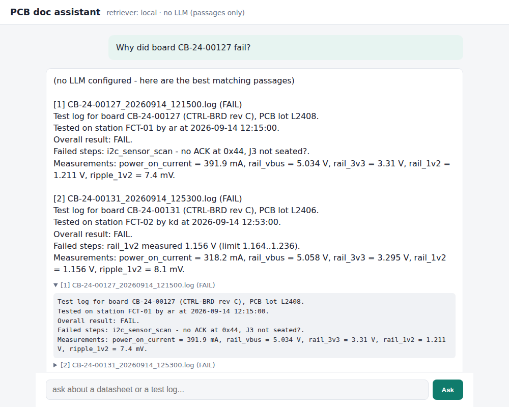

# pcb-rag-assistant

Ask questions about PCB datasheets and production test logs and get answers with sources.

> "What's the absolute max VIN of the AX3318?"
> "Why did board CB-24-00127 fail?"
> "Which test step fails most often?"

Built with **Azure OpenAI** (embeddings + gpt-4o-mini) and **Azure AI Search** (hybrid keyword + vector search). It also runs fully locally without an Azure account (BM25 search, and it shows the matching passages instead of a generated answer), which is how the tests and CI run.



## Why

During board bring-up and production testing, a lot of the questions are "what does the datasheet say about X" or "has this failure happened before". The answers are spread across PDFs, internal specs and thousands of test logs. I wanted to see how far a simple RAG setup gets, and where it breaks.

## How it works

```
data/                       ingest                         ask
 datasheets/*.pdf  ─┐   chunk + add title/section   ┌─> retrieve top k chunks
 datasheets/*.md   ─┼─>   embed (Azure OpenAI)  ────┤   + log stats for "how many" questions
 test_logs/*.log   ─┘   index (AI Search / BM25)    └─> gpt-4o-mini answers only from context, with [1] citations
```

Some things that mattered more than I expected:

- **Prefixing every chunk with the doc title and section.** A chunk like `VIN to GND: -0.3 V to 6.5 V` is useless on its own. With `AX3318 ... Section: Absolute Maximum Ratings` in front it gets found.
- **Test logs are parsed, not just chunked.** Each log becomes a short summary (board, lot, result, failed steps with values and limits). Raw logs embed badly because they're mostly numbers.
- **RAG can't count.** "Which step fails most often?" needs all 40 logs, not the top 5. Questions like that ("how many", "most often", "yield", "which boards") get a stats table computed with pandas added to the context.
- **Hybrid search on Azure.** Part numbers and serials like `CB-24-00127` need exact keyword matching, while "max input voltage of the LDO" needs semantic matching. Azure AI Search does both in one query.
- **The prompt is strict about limits.** Absolute max ratings are not operating conditions, and the model has to say so, cite everything, and admit when something isn't in the docs. A made-up voltage limit can kill a board.

## Results

The sample docs come with a small eval set: each question has the file that contains the answer and a value that has to appear in the retrieved text.

| eval set | retriever | right doc in top 1 | answer in top 1 | right doc in top 3 | answer in top 3 |
|---|---|---|---|---|---|
| `questions` (18, uses datasheet wording) | local BM25 | 94% | 78% | 100% | 100% |
| `questions_hard` (10, paraphrased) | local BM25 | 90% | 60% | 100% | 100% |

Run `python -m pcbrag eval --set questions_hard -k 1` with `RETRIEVER=azure` to compare against hybrid search. `--llm` also checks the final answers.

To be fair, the eval set is small and I wrote the questions knowing the docs, so these numbers are optimistic. The paraphrased set only passes locally because of a small abbreviation table (max → maximum, LDO → low-dropout regulator, cap → capacitor, ...). That's exactly the problem vector search solves properly.

Things that went wrong along the way:
- tf-idf + cosine ranked the BK1210 inductor page 7th for "what inductor should I use", so I switched the local retriever to BM25
- the first passages-only mode picked single lines, but the line with the answer often shares no words with the question, so it now shows whole passages

## Sample data

Everything in `data/` is **made up**: the AX3318 LDO, the BK1210 buck converter (as a PDF), a CTRL-BRD hardware spec, and 40 functional test logs. There are some real stories hidden in the logs (old rev B boards failing UART loopback, two boards with a low 1V2 rail, one lot drawing more current). I didn't want to put real vendor datasheets in a public repo. Regenerate the data with `python scripts/make_sample_data.py`.

To use your own docs, drop PDFs / .md / .txt into `data/datasheets/` and logs into `data/test_logs/`, then run ingest again. The log parser expects the format in the sample logs, so change the regex in `pcbrag/testlogs.py` for yours.

## Running it locally (no Azure)

```
python -m venv .venv
source .venv/bin/activate        # windows: .venv\Scripts\activate
pip install -r requirements.txt

python -m pcbrag ingest
python -m pcbrag ask "What is the dropout voltage of the AX3318 at 300 mA?"
python -m pcbrag chat
python -m pcbrag stats

uvicorn pcbrag.server:app --reload      # web UI on http://localhost:8000
```

Without Azure keys it shows the best matching passages instead of a generated answer.

## Azure setup

You need an Azure subscription with access to Azure OpenAI.

```
az login
az group create -n rg-pcb-rag -l eastus

# Azure OpenAI + two model deployments
az cognitiveservices account create -n <aoai-name> -g rg-pcb-rag -l eastus \
  --kind OpenAI --sku S0 --custom-domain <aoai-name>

az cognitiveservices account deployment create -n <aoai-name> -g rg-pcb-rag \
  --deployment-name gpt-4o-mini --model-name gpt-4o-mini --model-version 2024-07-18 \
  --model-format OpenAI --sku-name GlobalStandard --sku-capacity 10

az cognitiveservices account deployment create -n <aoai-name> -g rg-pcb-rag \
  --deployment-name text-embedding-3-small --model-name text-embedding-3-small --model-version 1 \
  --model-format OpenAI --sku-name Standard --sku-capacity 10

az cognitiveservices account keys list -n <aoai-name> -g rg-pcb-rag --query key1 -o tsv

# Azure AI Search (free tier is enough for this, one per subscription)
az search service create -n <search-name> -g rg-pcb-rag --sku free -l eastus
az search admin-key show --service-name <search-name> -g rg-pcb-rag --query primaryKey -o tsv
```

Model versions and SKUs differ by region. If a deployment command fails, create the deployments in the Azure AI Foundry portal instead and put their names in `.env`.

Then:

```
cp .env.example .env     # fill in endpoints + keys, set RETRIEVER=azure
python -m pcbrag ingest --recreate
python -m pcbrag ask "Why did board CB-24-00127 fail?"
```

You can also keep `RETRIEVER=local` and only use Azure OpenAI for the answers. That way you don't need AI Search at all.

**Costs:** the sample data is tiny, so embedding it costs a fraction of a cent and each question is about 2-3k tokens on gpt-4o-mini. Free-tier search is free. Delete the resource group when you're done: `az group delete -n rg-pcb-rag`.

## Project layout

```
pcbrag/
  documents.py     loading pdf/md/logs + chunking
  testlogs.py      log parser, summaries, failure stats
  local_index.py   BM25 retriever
  azure_index.py   Azure OpenAI embeddings + AI Search index/upload/hybrid search
  assistant.py     retrieval -> prompt -> answer with citations
  evaluate.py      eval on eval/*.jsonl
  server.py        FastAPI + static/index.html
  __main__.py      CLI
scripts/make_sample_data.py
eval/questions.jsonl, questions_hard.jsonl
tests/             runs without Azure (fake clients for the Azure parts)
```

## TODO

- [ ] semantic ranker on Azure AI Search (not on free tier)
- [ ] read tables out of PDFs properly. pypdf flattens them, which is fine for this sample but not for real datasheets
- [ ] let the model call the stats function as a tool instead of keyword routing
- [ ] bigger eval set with questions from other people
